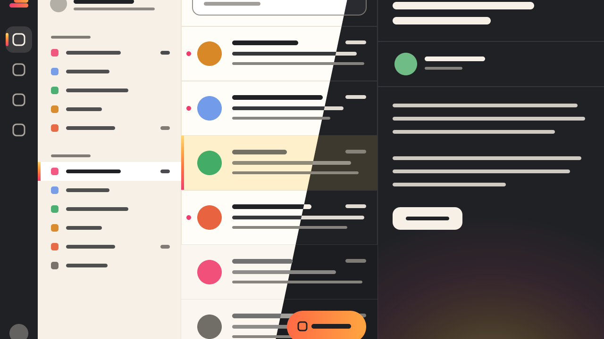

# Soluma Sunrise

Soluma's theme for [Bulwark Webmail](https://bulwarkmail.org): warm Paper & Graphite grounds, Geist type,
ink actions, an always-dark navigation rail, and the Sunrise gradient kept for small marks (what is
current, what is unread, Compose). Light and dark. Needs Bulwark 1.21.0 or newer.

## Install

Admins install it from **Admin → Marketplace** in Bulwark once it is listed on
[Bulwark Extensions](https://extensions.bulwarkmail.org). Users then pick it under
**Settings → Appearance**.

## Files

- `manifest.json`: metadata, design tokens, radii and typography (Theme API v2)
- `theme.css`: colour variables for light (`:root`) and dark (`.dark`)
- `skin.css`: component styling
- `preview.svg`, `icon.png`, `banner.png`: images for the settings card and the directory listing

## License

AGPL-3.0, see [LICENSE](../../LICENSE).
